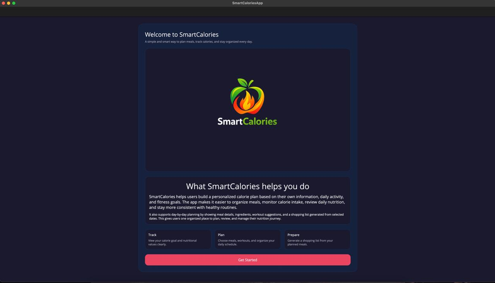
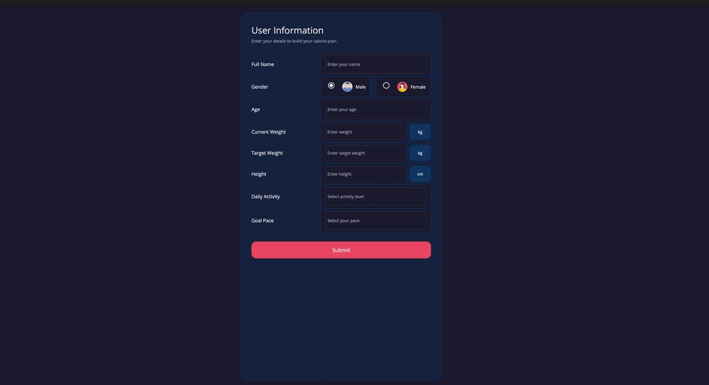
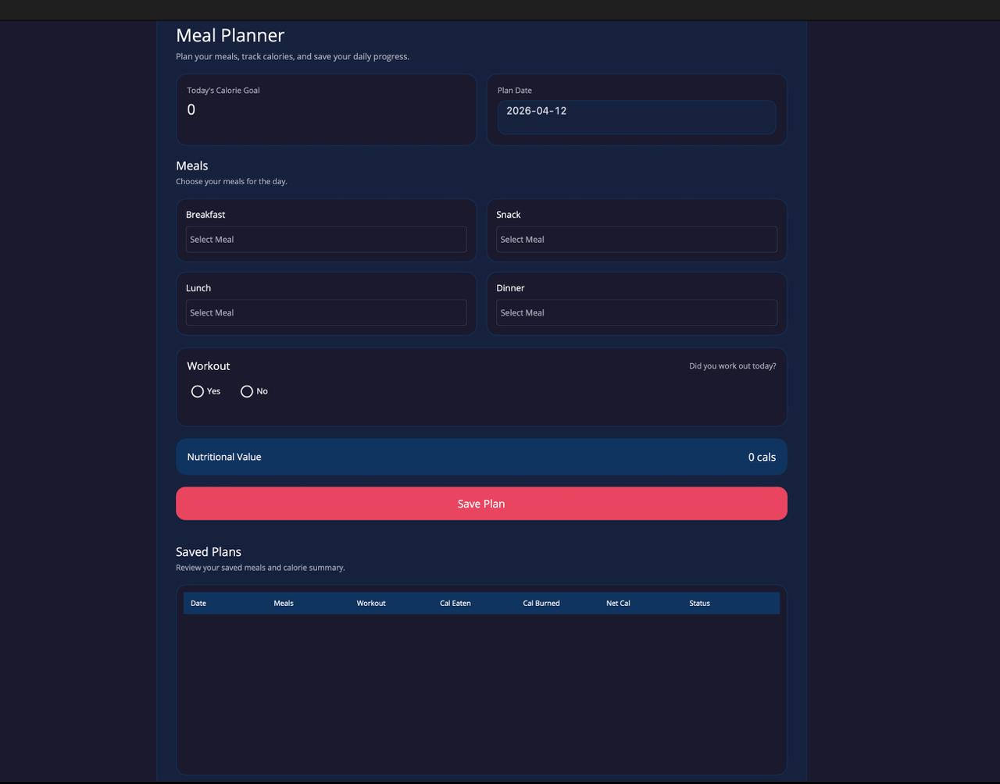
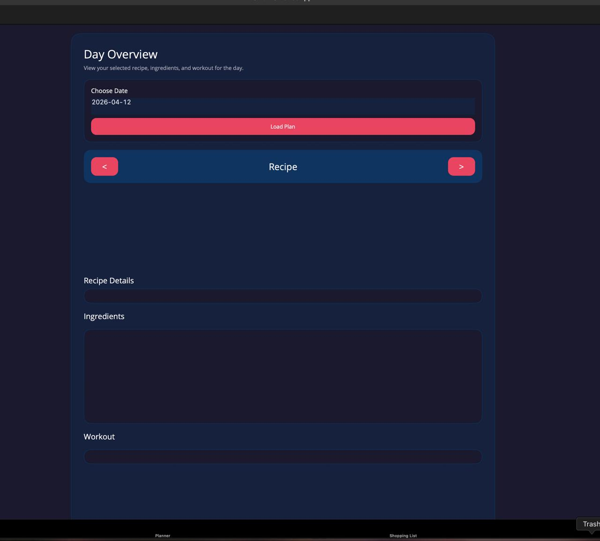
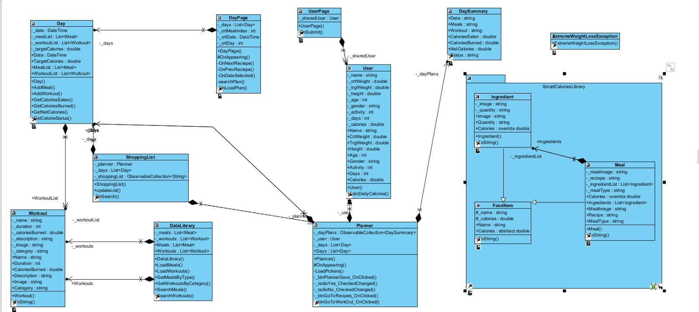

# Smart Calories

**Smart Calories** is an app designed to help users achieve their nutritional goals. In the app, the user enters their personal data, their goal, and the time they want to take to achieve it.

After that, the user can create a daily plan where they organize their meals and workouts. On a different page, the user can review their plans, check recipes, ingredients, and workouts. Finally, the app allows users to generate a shopping list based on the ingredients needed for a selected period.

---

## Team S.A.D

Our team **S.A.D** is made up of:

- **Hossam Abdelaziz**
- **Antesh Kumar Sharma**
- **David Rosales**

---

## Responsibilities

### Hossam Abdelaziz
**Responsible for:**
- Planner Page
- Welcome Page
- `DaySummary` Class
- `DataLibrary` Class
- `Workouts` Class
- `Day` Class

**Role:**
- Developed plan creation functionality
- Created meals, ingredients, and workouts logic
- Polished UI and performed testing

---

### Antesh Kumar Sharma
**Responsible for:**
- User Page
- Data sharing between pages
- `User` Class
- `Ingredient` Class

**Role:**
- Managed user data collection
- Implemented data flow across pages
- Unified UI colors

---

### David Rosales
**Responsible for:**
- Shopping List Page
- Day Page
- `FoodItem` Class
- `Meal` Class

**Role:**
- Developed detailed plan visualization
- Displayed recipes, ingredients, and workouts
- Collected images for the app

---

## Team Collaboration

Although each member was responsible for specific parts of the app, we all collaborated on problem-solving and contributed to improving each other's code.

---

##  App Pages

### User Information Page
-Explains to the user the app 

---

### User Information Page
- Users enter their personal data
- Define their goals for the app

---

### Planner Page
- Users plan their meals
- Schedule their workouts

---

### Day Page
- Displays daily plans created by the user

---

### Shopping List Page
- Generates a shopping list
- Based on selected days and planned meals

---

## UML Diagram

This is the UML diagram for the **Smart Calories** app.

